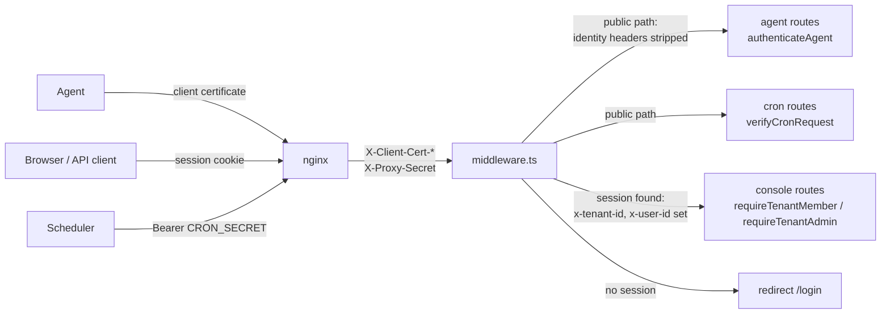
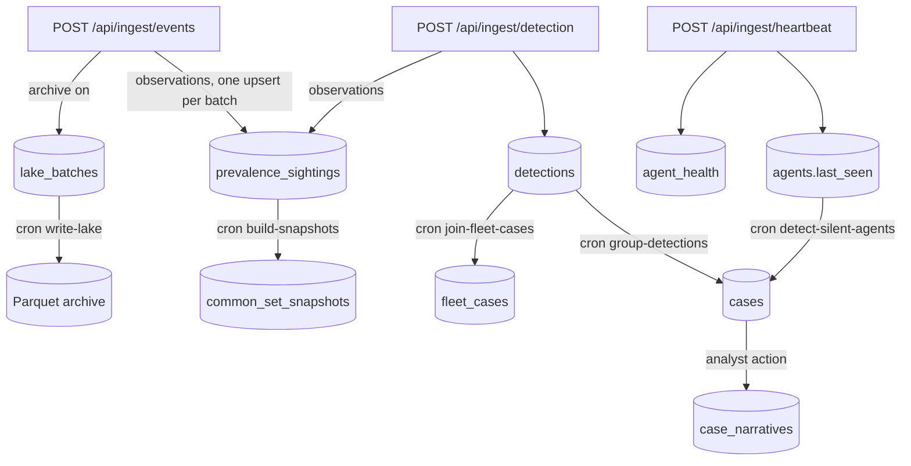

# Architecture

This page covers how the server is put together: the processes that run, the three kinds of
caller and the path each request takes, where the code lives, and how the functional modules
feed each other. The agent-facing protocol is detailed in [Agent protocol](agent-protocol.md),
and the checks on each path in [Security model](security-model.md).

## Processes

```text
 agents ──mTLS──▶ nginx :8443 ──▶ Next.js app :3000 ──▶ PostgreSQL
 browsers ───────▶   (proxy)       (Node runtime)   └──▶ telemetry archive (optional:
 scheduler ──────▶                                        a directory or an S3 bucket)
                                         │
                                         └──▶ LLM endpoint (optional, case narratives)
                                         └──▶ webhook receivers (optional, notifications)
```

| Process | What it is | Defined in |
| --- | --- | --- |
| Proxy | nginx. Terminates TLS on port 8443, verifies agent client certificates, passes the verified subject and a shared secret to the application, and applies body-size and rate limits per path. | [`nginx.conf`](../nginx.conf) |
| Application | One Next.js 14 application (App Router, TypeScript). Serves the agent endpoints, the console's API, the console pages and the scheduled-job routes. | [`app/`](../app), [`lib/`](../lib) |
| Database | PostgreSQL 15, the system of record for every tenant, agent, detection, case, release and audit row. | [`prisma/schema.prisma`](../prisma/schema.prisma) |
| Telemetry archive | Optional Parquet files on a local directory or an S3-compatible bucket, written by a scheduled job. | [`lib/lake-*.ts`](../lib/lake-store.ts) |

There is no background worker process. Everything that is not a response to a request runs
when an external scheduler calls one of the [scheduled-job routes](scheduled-jobs.md). The
application keeps no state between requests other than what is in PostgreSQL, the archive and
the file-system [artifact store](content-and-releases.md#the-artifact-store), so several
instances can run behind the proxy; the places that need mutual exclusion take PostgreSQL
advisory locks rather than in-process ones.

### Runtimes inside the application

Next.js compiles parts of the application for two runtimes:

- **Edge.** [`middleware.ts`](../middleware.ts) runs on every `/api/*` and `/console/*` request
  before the route. The Edge runtime cannot load Prisma, so the middleware asks the
  application's own `/api/auth/get-session` route over the loopback to read a session
  ([`lib/session-lookup.ts`](../lib/session-lookup.ts)).
- **Node.** Route handlers, server components and [`instrumentation.ts`](../instrumentation.ts),
  which runs once at start-up. It loads
  [`instrumentation-node.ts`](../instrumentation-node.ts) only on the Node runtime, which checks
  that the decoy table exists and installs the shutdown handler that flushes pending decoy alarms.

## Three kinds of caller

Every request belongs to exactly one of three identities, and the identities never mix: an
agent cannot act with a session, and a session cannot act as an agent.



| Caller | Credential | Checked by | Tenant comes from |
| --- | --- | --- | --- |
| Agent | mTLS client certificate whose common name is an enrolled agent's enrollment ID | nginx (certificate), then [`authenticateAgent`](../lib/agent-auth.ts) (proxy secret, verified subject, enrolled agent) | The agent row the certificate names |
| Console user | better-auth session cookie with an active organization | [`middleware.ts`](../middleware.ts), then [`requireTenantMember`](../lib/admin-auth.ts) or [`requireTenantAdmin`](../lib/admin-auth.ts) in the route; [`requireConsoleTenant`](../lib/console-session.ts) in pages | The session's `activeOrganizationId` |
| Scheduler | `Authorization: Bearer <CRON_SECRET>` | [`verifyCronRequest`](../lib/cron-auth.ts) | None: jobs iterate over every tenant |

The middleware keeps a fixed list of public paths (agent ingest and downloads, `/api/auth`,
`/api/health`, `/api/cron/*`, `/login`, `/`). On those it removes any client-supplied
`x-tenant-id` and `x-user-id` and lets the route authenticate the caller itself. On every other
matched path it looks up the session, redirects to `/login` without one, and otherwise sets those
two headers from the session. Route handlers read the tenant only from them, through
[`getTenantId`](../lib/tenant.ts), never from the request body.

## Code layout

| Path | Contents |
| --- | --- |
| [`app/api/`](../app/api) | Route handlers. One directory per resource; the path is the URL. |
| [`app/console/`](../app/console), [`app/login/`](../app/login) | Console pages (React server components). |
| [`components/`](../components) | Client components used by the console pages. |
| [`lib/`](../lib) | Server logic. Most of it is pure functions over plain data, with the Prisma calls kept in thin store modules or in the route, so the logic is unit-testable without a database. |
| [`assistant/`](../assistant) | The case-narrative evidence graph, prompt and LLM client. |
| [`prisma/schema.prisma`](../prisma/schema.prisma) | The database schema, including the better-auth tables. |
| [`middleware.ts`](../middleware.ts) | Session check and identity headers. |
| [`nginx.conf`](../nginx.conf), [`Dockerfile`](../Dockerfile), [`docker-compose.yml`](../docker-compose.yml) | The proxy and the development stack. |
| [`scripts/`](../scripts) | Development certificates, the standalone start script and the test runner. |
| [`tests/`](../tests) | Unit, integration and acceptance suites ([Testing](testing.md)). |
| `ingest/`, `fleet/`, `hunt/`, ... | Module notes only, no code: the design and status of each functional area. |

Route handlers either wrap their body in [`route`](../lib/http/handler.ts), which maps
`HttpError` subclasses to their status, a `ZodError` to `400` and anything else to a logged
`500` with no detail, or do the same mapping in their own `try`/`catch`. No stack trace or
driver message reaches a caller.

## Functional modules

The server's functions are organized by area. Each row names the routes and library modules
that implement it; the module note has the design and status.

| Area | What it does | Routes | Library | Note |
| --- | --- | --- | --- | --- |
| Ingest | Accepts events, detections, heartbeats and decoy registrations from enrolled agents | `app/api/ingest/*`, `app/api/v1/ingest/*` | [`detection-payload.ts`](../lib/detection-payload.ts), [`health-beacon.ts`](../lib/health-beacon.ts), [`ingest-stats.ts`](../lib/ingest-stats.ts), [`decoy.ts`](../lib/decoy.ts) | [ingest](../ingest/README.md) |
| Cases | Groups one host's detections into cases; opens a case for a silent agent | `app/api/cases/*`, `app/api/cron/group-detections`, `app/api/cron/detect-silent-agents` | [`case-grouping.ts`](../lib/case-grouping.ts), [`case-grouping-store.ts`](../lib/case-grouping-store.ts), [`silent-agent-case.ts`](../lib/silent-agent-case.ts), [`case-detail.ts`](../lib/case-detail.ts) | [assistant](../assistant/README.md) |
| Fleet correlation | Joins cases of several hosts that share a file hash or a signed-in identity into fleet cases | `app/api/fleet-cases/*`, `app/api/cron/join-fleet-cases` | [`fleet-case.ts`](../lib/fleet-case.ts), [`fleet-case-load.ts`](../lib/fleet-case-load.ts) | [fleet](../fleet/README.md) |
| Prevalence | Per-tenant first-seen, last-seen and host counts for hashes, paths, parent-child pairs and domains; the signed common-set snapshot | `app/api/prevalence`, `app/api/snapshot/*`, `app/api/cron/prune-prevalence`, `app/api/cron/build-snapshots` | [`prevalence.ts`](../lib/prevalence.ts), [`common-set-snapshot.ts`](../lib/common-set-snapshot.ts), [`snapshot-publish.ts`](../lib/snapshot-publish.ts) | [prevalence](../prevalence/README.md) |
| Entity graph | A case's subgraph and pivots from a hash, path or domain to every host that showed it, computed on read | `app/api/cases/[id]/graph`, `app/api/graph/pivot` | [`graph.ts`](../lib/graph.ts) | [graph](../graph/README.md) |
| Hunting | Saved and scheduled hunts, ad-hoc search over detections, cases and the archive, drafts of Sigma rules and IOC sets | `app/api/hunts/*`, `app/api/cron/run-hunts` | [`hunt.ts`](../lib/hunt.ts), [`hunt-search.ts`](../lib/hunt-search.ts), [`hunt-runner.ts`](../lib/hunt-runner.ts), [`hunt-graduation.ts`](../lib/hunt-graduation.ts) | [hunt](../hunt/README.md) |
| Telemetry archive | Queues accepted event batches and writes them as Parquet, with per-tenant retention and audited deletion | `app/api/cron/write-lake`, `app/api/cron/prune-lake` | [`lake-writer.ts`](../lib/lake-writer.ts), [`lake-store.ts`](../lib/lake-store.ts), [`lake-s3-store.ts`](../lib/lake-s3-store.ts), [`lake-retention.ts`](../lib/lake-retention.ts), [`lake-query.ts`](../lib/lake-query.ts) | [datalake](../datalake/README.md) |
| Fleet operations | Agent and ingest health, ring status, ring assignment, halt and rollback | `app/api/ops/*`, `app/api/rings/*`, `app/api/agents/*`, `app/api/content/*`, `app/api/release/*` | [`fleet-health.ts`](../lib/fleet-health.ts), [`rings.ts`](../lib/rings.ts), [`ring-actions.ts`](../lib/ring-actions.ts), [`release-publish.ts`](../lib/release-publish.ts) | [ops](../ops/README.md), [Content and releases](content-and-releases.md) |
| Assistant | LLM-written case narratives over an allowlisted evidence graph, with citations checked against the case | `app/api/cases/[id]/narrative/regenerate` | [`assistant/`](../assistant), [`case-narrative.ts`](../lib/case-narrative.ts) | [assistant](../assistant/README.md) |
| Integrations | Signed webhooks for host health changes and new hunt matches, through an outbox | `app/api/notify/*`, `app/api/cron/deliver-notifications` | [`lib/notify/`](../lib/notify) | [integrations](../integrations/README.md) |
| Tenancy | Tenant provisioning, the tenant–organization pairing, roles | `app/api/admin/tenants`, `app/api/auth/*` | [`tenant-provisioning.ts`](../lib/tenant-provisioning.ts), [`auth.ts`](../lib/auth.ts), [`admin-auth.ts`](../lib/admin-auth.ts) | [Security model](security-model.md) |

Three areas are planned and have notes but no code yet:
[cloud-side detection](../cloud-detection/README.md), the
[DFIR workbench](../forensics/README.md) and [attack disruption](../disruption/README.md).

The corpus routes (`app/api/corpus/*`) store benign telemetry samples per tenant and export
a finalized version as JSONL for model training. They are not yet part of the agent protocol:
the submit route is not on the middleware's list of agent paths.

## Data flows

### From an agent's upload to a case



- **Events** are not stored in PostgreSQL. Every accepted event feeds the prevalence counters;
  with the archive on, the batch is also queued in `lake_batches` before the request is answered,
  and `write-lake` turns the queue into Parquet. With the archive off, events are counted and
  dropped.
- **Detections** are stored as they arrive, with no case. `group-detections` later assigns each
  ungrouped detection to a case of the same agent: same or related ATT&CK technique within 30
  minutes ([`case-grouping.ts`](../lib/case-grouping.ts)). `join-fleet-cases` then links
  detections of different agents that share an executed file hash or a non-generic identity
  within 24 hours into one fleet case ([`fleet-case.ts`](../lib/fleet-case.ts)).
- **Heartbeats** refresh `agents.last_seen` and store the latest health beacon. An agent with no
  heartbeat for five minutes is silent: `detect-silent-agents` opens one case for it, and the
  notification job tells the tenant's webhooks.
- **Reads** combine these: `GET /api/cases/[id]` returns a case's detections, the fleet
  prevalence of what each touched, the files its ransomware detections say were renamed or
  deleted, and the latest narrative, marked stale when a detection joined the case after the
  narrative was written. `GET /api/cases/[id]/graph` returns the case's entity graph.

### From an operator to the fleet

Content, binary releases, key rotations and snapshots flow the other way: an operator stages
artifacts and publishes a manifest signed offline, the server checks it and serves it to the
agents of the ring, and agents verify every signature themselves. The server never holds a
signing key. [Content and releases](content-and-releases.md) covers this path.
