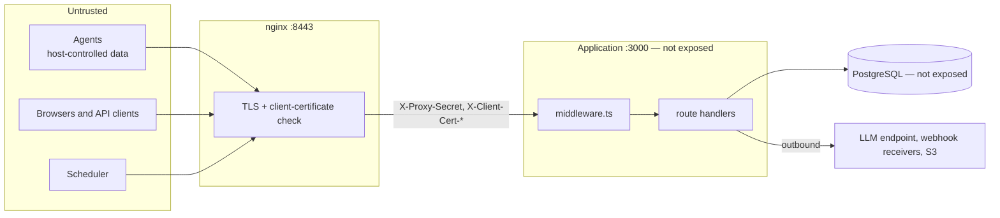

# Security model

What the server trusts, how each caller proves who it is, how one tenant is kept from another,
where keys and secrets live, and what is not defended yet. The server is alpha software: the last
section is part of the model, not a footnote.

## Trust boundaries

- **The proxy is the only way in.** nginx terminates TLS, verifies client certificates against
  the agent CA, and writes the certificate headers and the shared proxy secret on every request,
  overwriting whatever a client sent. The application port and the database must not be reachable
  from anywhere else: the proxy secret is what tells the application that the certificate headers
  were written by nginx.
- **An agent is trusted for its identity, not its data.** A valid certificate proves which
  enrolled agent is calling. Everything it uploads is still hostile input: the host may be
  compromised, and much of what an agent reports (command lines, paths, host names, domains) is
  chosen by processes on that host.
- **Console users are trusted within their tenant and role.**
- **The server is not trusted with signing.** It never holds the keys that sign content,
  releases, key rotations or (outside lab use) snapshots, so a compromised server can withhold
  updates but cannot make agents install something of its own.

## Authentication

### Agents

mTLS, then four checks in [`authenticateAgent`](../lib/agent-auth.ts): the proxy secret (constant
time), a verified certificate, a CN in the subject, and an `agents` row with that enrollment ID.
[Agent protocol](agent-protocol.md#how-a-request-is-authenticated) has the details. nginx refuses
the agent paths without a valid certificate before the application sees them.

A certificate is the whole credential. The server does not issue certificates and keeps no
revocation list: an agent stays able to authenticate as long as nginx accepts its certificate and
its `agents` row exists.

### Console users

Users sign in with email and password through [better-auth](https://www.better-auth.com)
([`lib/auth.ts`](../lib/auth.ts)), mounted at `/api/auth/*`. Sessions are cookies signed with
`BETTER_AUTH_SECRET`. better-auth refuses a request that carries a session cookie without an
`Origin` it trusts; the trusted origins are set in `lib/auth.ts`.

Tenancy uses better-auth's organization plugin. An organization and its tenant share one id, and
a session's `activeOrganizationId` is the tenant the user acts in. Users cannot create
organizations, and organization deletion is disabled outright, since it would orphan the tenant's
data; tenants are created only by [`provisionTenant`](../lib/tenant-provisioning.ts), which writes
the tenant, the organization and the owner membership in one transaction.

Sign-up is open: anyone who can reach `/api/auth/sign-up/email` can create a user. A user who is
a member of no organization can act on no tenant.

### Identity headers

[`middleware.ts`](../middleware.ts) runs before every `/api/*` and `/console/*` route:

- On public paths (agent endpoints, `/api/auth`, `/api/health`, `/api/cron/*`, `/login`, `/`) it
  deletes any client-supplied `x-tenant-id` and `x-user-id` and passes the request on. Those
  routes authenticate their caller themselves.
- Everywhere else it reads the session and redirects to `/login` without one. With one, it deletes
  the client's identity headers first, then sets `x-user-id` and, when the session has an active
  organization, `x-tenant-id` ([`buildIdentityHeaders`](../lib/tenant.ts)). Deleting first matters:
  a session without an active organization must not forward a tenant the client named.

The middleware runs on the Edge runtime, which cannot use the database, so it reads the session by
calling the application's own `/api/auth/get-session` on `127.0.0.1` with the request's cookie
([`lookupSession`](../lib/session-lookup.ts)). The address is never derived from the request's
`Host` or `X-Forwarded-Host`, the call times out after 5 seconds, and any failure is treated as
"no session".

Console pages do not depend on these headers: they read the session themselves with
[`requireConsoleTenant`](../lib/console-session.ts).

### Scheduler

`/api/cron/*` routes require `Authorization: Bearer <CRON_SECRET>`
([`verifyCronRequest`](../lib/cron-auth.ts)). The comparison is constant time, and an unset or
empty `CRON_SECRET` refuses every call (`500`) instead of matching a literal such as
`Bearer undefined`. nginx limits `/api/cron/` to 10 requests per second per client address, with
a burst of 20.

### Platform operators

Creating a tenant (`POST /api/admin/tenants`) happens before the caller has a tenant to hold a role
in. It is allowed only to the user IDs listed in `PLATFORM_OPERATOR_USER_IDS`
([`requirePlatformOperator`](../lib/platform-operator.ts)); unset means nobody.

## Authorization

Inside a tenant, the roles are better-auth's own, stored in `auth_member.role`: `owner`, `admin`
and `member`. A member with several roles has them comma-separated, and
[`isAdminRole`](../lib/admin-auth.ts) is the one predicate that reads them.

| Gate | Answers | Routes |
| --- | --- | --- |
| [`requireTenantMember`](../lib/admin-auth.ts) | `401` without an active tenant | Every tenant read (cases, fleet cases, graph, prevalence, ops, rings, agents, releases, notification channels list), hunts and searches, case narratives |
| [`requireTenantAdmin`](../lib/admin-auth.ts) | `401` as above, `403` for a plain member or a user with no membership | Enrollment, ring assignment, content release, halt, rollback and IOC staging, binary release, notification channel create, change, test and delete, corpus finalization |
| [`requirePlatformOperator`](../lib/platform-operator.ts) | `403` unless listed | Tenant provisioning |

Console pages that show admin actions check the role to decide what to render; the routes behind
those actions check it again.

## Tenant isolation

Isolation is enforced in the application, not by the database: there are no row-level security
policies. Every query a route runs carries the caller's tenant id, taken from the agent row or the
session, never from the request. Practices that follow from it:

- A record of another tenant is answered `404`, not `403`, so ids cannot be probed.
- `enrollment_id` is unique across tenants. Enrolling an ID another tenant uses answers `409`
  without saying anything about that agent.
- The artifact store is shared, so the content and release routes serve only paths listed in the
  agent's own active manifest, never a path looked up directly.
- Prevalence, snapshots, hunts, searches, the archive (partitioned `tenant=<id>/`) and webhooks are
  per tenant; nothing joins rows across tenants. Archive reads check every key against the tenant,
  day and type asked for.
- Hunts are structured queries compiled to parameterized SQL, never SQL from the user, so a hunt
  cannot name a table or another tenant.

[`tests/integration/tenancy.test.ts`](../tests/integration/tenancy.test.ts) and the per-route
integration tests check that another tenant's rows stay out of reach.

## Keys and secrets

| Item | Where it lives | Notes |
| --- | --- | --- |
| Content, release and recovery signing keys | Offline, with the operator | The server checks shape and hashes, never signatures. Agents verify. |
| `snapshot` signing key | A `SnapshotSigner` | Only the public test key exists today (`SYNTHAEA_SNAPSHOT_SIGNER=test`); snapshots signed with it are for labs only. |
| Agent CA and server certificate | Mounted into nginx | The development script writes throwaway ones. |
| `NGINX_PROXY_SECRET` | Environment of the proxy and the application | Must be identical on both. |
| `BETTER_AUTH_SECRET`, `CRON_SECRET` | Environment of the application | |
| Webhook signing secrets and URLs | `notification_channels`, sealed with AES-256-GCM under `NOTIFY_SECRET_KEY`, channel id as associated data | Never returned after creation; only the URL's host is ever shown. Keys rotate through `NOTIFY_SECRET_KEY_PREVIOUS` ([`lib/notify/secret.ts`](../lib/notify/secret.ts)). |
| Decoy credentials | Only their SHA-256, in `decoy_tokens` | The server can recognize a decoy, not produce one. |

## Defenses by area

### Hostile agent input

Agent payloads are bounded before they are stored: body and batch sizes, string, array, depth and
key limits in event trees, bounded technique and identifier fields, NUL replacement
([Agent protocol](agent-protocol.md#detections)). Text a process on the host controls is cut, not
refused, so a process cannot silence its own detections by padding them. Event types become an
archive path segment only if they match `[a-z][a-z0-9_]{0,63}`. A host name is self-declared and
is shown as such: it is bounded and stripped of control characters wherever it reaches a title or
an alarm.

### Decoy credentials

An agent registers the hashes of the fake credentials it planted. If a request to a
bearer-authenticated route presents one, someone read the canary file on that host and is using
what they found: [`reportDecoyUse`](../lib/decoy.ts) records a detection against every agent that
holds the hash. The work starts after the `401` is ready, so a decoy is not distinguishable by
response time; concurrent lookups are bounded, the oldest queued lookup is shed under a flood, and
alarms are limited to one per decoy and address per minute. The address recorded is `X-Real-IP`
only when the request carries the proxy secret, `unverified` otherwise. In production the image
sets `NEXT_MANUAL_SIG_HANDLE` so that a pending alarm is written before the process exits on
`SIGTERM` (at most 5 seconds).

### Outbound requests

- **Webhooks** ([`lib/notify/guard.ts`](../lib/notify/guard.ts)) go only to `https` URLs on port
  443 or a port in `NOTIFY_ALLOWED_PORTS`, with no credentials in the URL. The host is resolved
  once, every address is checked, and the connection is made to the checked address with the
  original `Host` and SNI, so a DNS answer cannot change between check and connect. Private
  addresses are refused unless `NOTIFY_ALLOWED_PRIVATE_HOSTS` allows that host for that tenant;
  loopback, link-local and known cloud metadata addresses are refused for everyone. Payloads carry
  no detection content and are signed with HMAC-SHA256 (see the
  [integrations note](../integrations/README.md)).
- **Case narratives** send the LLM endpoint only an allowlisted evidence graph built from the
  case's detections ([`assistant/evidence-graph.ts`](../assistant/evidence-graph.ts)), never raw
  rows, with command lines cut to 200 characters. Every citation in the answer is checked against
  the case's detections and dropped if it names another. The default endpoint is a local Ollama;
  pointing `LLM_BASE_URL` elsewhere sends that evidence to that provider.

### Audit

Every administrative change writes an `audit_logs` row with the tenant, user, action, resource and
details: enrollment, ring assignment, content and binary releases, halt, rollback, auto-halt,
IOC staging, corpus finalization, notification channel changes, narrative generation and tenant
creation ([`AuditAction`](../lib/audit.ts)). Changes that go through
[`recordAudit`](../lib/audit.ts) write the row in the same transaction as the change.

### Errors

Unexpected failures are logged and answered `500 { "error": "Internal server error" }`, with no
stack or driver message ([`route`](../lib/http/handler.ts)).

## Not defended yet

- **Production hardening.** The supplied stack runs Next.js in development mode, ships
  development certificates and default secrets, and publishes PostgreSQL. See
  [Deployment](deployment.md#before-the-stack-leaves-one-machine).
- **The console over plain HTTP.** In the development stack the console is reached on port 3000
  without TLS, and better-auth's trusted origins name only the development addresses.
- **Agent revocation.** No certificate revocation list, and no API to unenroll an agent.
- **Rate limiting.** Only the cron routes (nginx), hunt runs and searches (per tenant), webhook
  test sends and notification delivery are rate limited. Sign-in, sign-up and the agent endpoints
  are not.
- **Database-level isolation.** A query that forgets its tenant filter is not caught by
  PostgreSQL.
- **Release manifest URLs.** A `manifestUrl` other than `storage://` is fetched as given, without
  the webhook guard; only tenant admins can set one.
- **Shared artifact store.** All tenants' artifacts share one directory, so a tenant admin's
  manifest may list any hash already in it, another tenant's artifact included when its hash is
  known.
- **Trusted origins** for better-auth are fixed in code ([`lib/auth.ts`](../lib/auth.ts)) to
  `http://localhost:3000` and `http://localhost:8443`; serving the console under another origin
  needs a code change.
